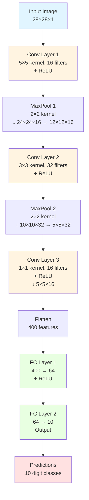
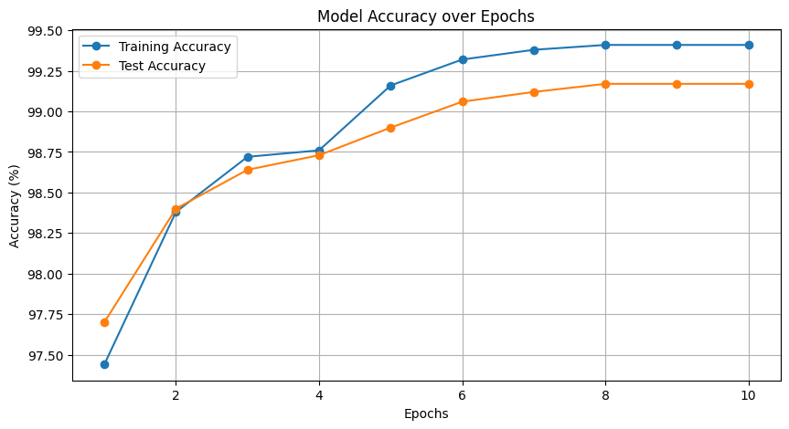

# MNIST-Image-Classification-using-CNN

This repository contains a PyTorch implementation of a Convolutional Neural Network (CNN) model for classifying MNIST handwritten digits.

#### CNN Model Architecture Flow

### Model Architecture
> This CNN model is a custom architecture for side-project purposes with image classification tasks. It is designed to be straightforward and efficient, providing a good balance between performance and computational cost, especially for tasks involving less complex images or smaller datasets.

The CNN model used in this project consists of the following layers:
- **Convolutional Layer 1**: 16 filters, 5x5 kernel size, ReLU activation
- **Max Pooling Layer 1**: 2x2 kernel size
- **Convolutional Layer 2**: 32 filters, 3x3 kernel size, ReLU activation
- **Max Pooling Layer 2**: 2x2 kernel size
- **Convolutional Layer 3**: 16 filters, 1x1 kernel size, ReLU activation
- **Fully Connected Layer 1**: 64 units, ReLU activation
- **Fully Connected Layer 2 (Output)**: 10 units (corresponding to 10 digit classes)

#### Training Pipeline Structure

### Data Processing
The MNIST dataset is used for this project. The data is preprocessed as follows:

- **Grayscale Conversion:** The input images are converted to grayscale (1 channel).
- **Resizing:** The images are resized to 28x28 pixels.
- **Normalization:** The pixel values are converted to tensors and normalized to the range [0, 1].

### Training Function
The train_model() function is responsible for training the CNN model. It includes the following key components:

- **Device:** The model is moved to the available GPU device (if CUDA is available) or CPU.
- **Loss Function:** The CrossEntropyLoss is used as the loss function.
- **Optimizer:** The Adam optimizer is used with a learning rate of 0.001.
- **Learning Rate Scheduler:** A MultiStepLR scheduler is used to decrease the learning rate by a factor of 0.01 at epochs 5 and 8.
- **Training Loop:** The model is trained for 10 epochs, with the training loss and test accuracy being calculated and reported at the end of each epoch.

### Learning Rate and Model Performance
- **Learning Rate:** The initial learning rate is set to 0.001, and the MultiStepLR scheduler is used to reduce the learning rate during training.
- **Model Performance:** The final test accuracy achieved by the model is 99.17%.

### Comparison with Famous CNN Architectures
+ **VGGNet:**
VGGNet is known for its simplicity, using mostly 3x3 convolutional layers stacked on top of each other in increasing depths.
Typically, VGG models are much deeper (e.g., VGG16, VGG19) with layers in the range of 16 to 19 layers.
This model has fewer layers and uses a varied kernel size which is not characteristic of VGGNet.
+ **AlexNet:**
AlexNet typically has 5 convolutional layers with varying kernel sizes (11x11, 5x5, and 3x3).
It also includes multiple fully connected layers at the end, similar to your model, but with a different configuration and more parameters.
AlexNet was designed for a larger and more complex dataset (ImageNet), unlike the relatively simpler MNIST.
+ **ResNet:**
ResNet architectures make extensive use of residual connections, which are not present in this model.
ResNet models also tend to be much deeper and are designed to solve problems of vanishing gradients in very deep networks.

### Characteristics of the Model
+ **Simplicity and Efficiency:** This model is simpler and likely more computationally efficient due to fewer layers and parameters. This makes it suitable for datasets like MNIST, which do not require very deep architectures due to the lower complexity of the data.
+ **Custom Kernel Sizes:** The use of different kernel sizes (5x5, 3x3, and 1x1) in successive layers without following a fixed pattern is more indicative of a custom model tailored to the specifics of the task rather than following a standard architecture pattern.
+ **Adaptability:** This architecture is likely designed to quickly learn spatial hierarchies with fewer parameters and can be easily modified or extended for similar scale problems.
